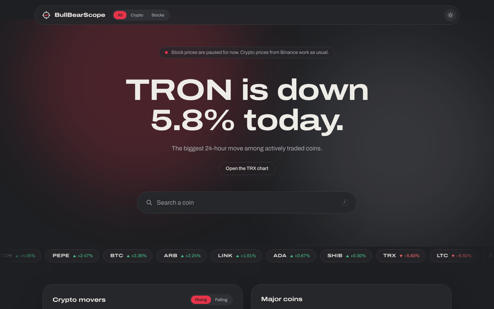
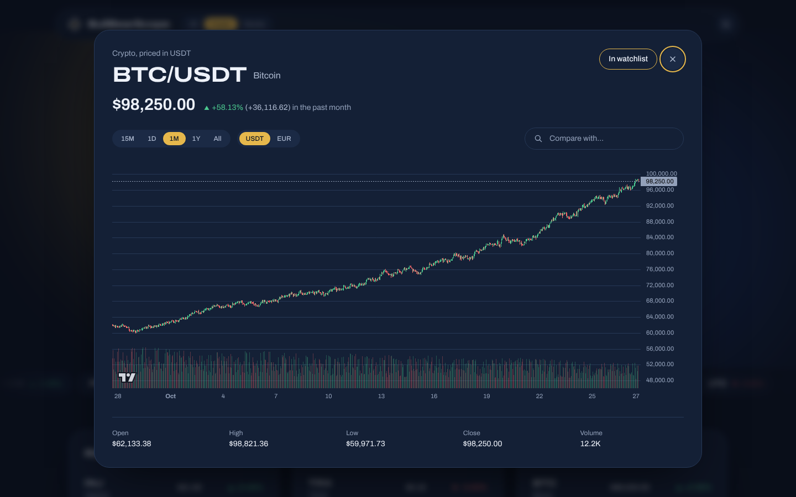
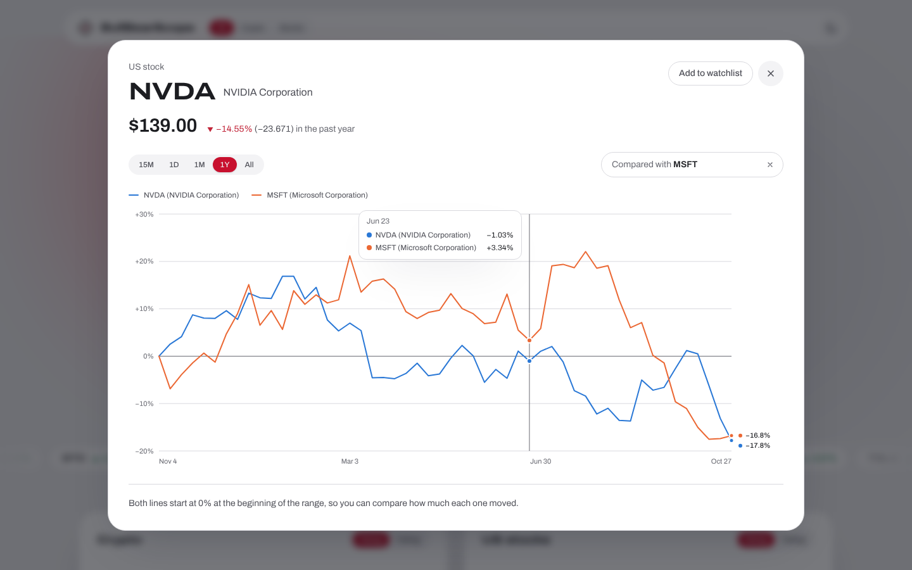
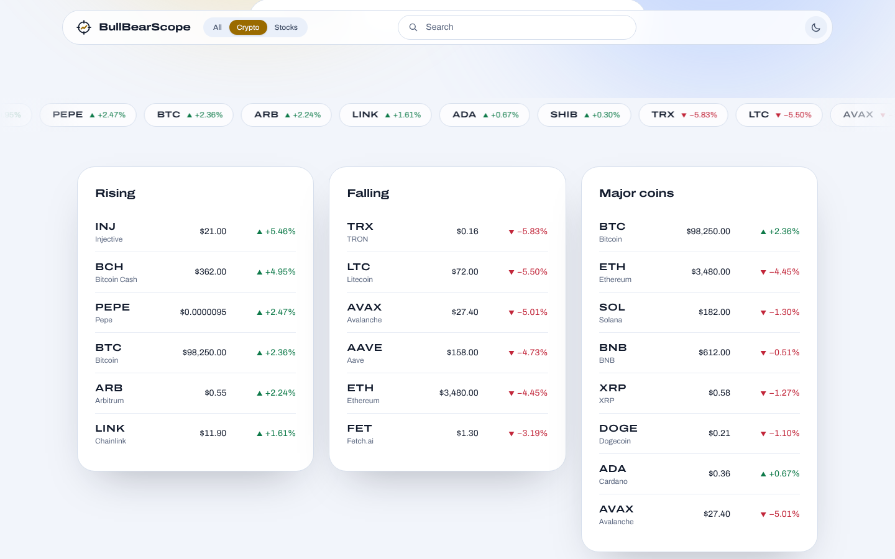
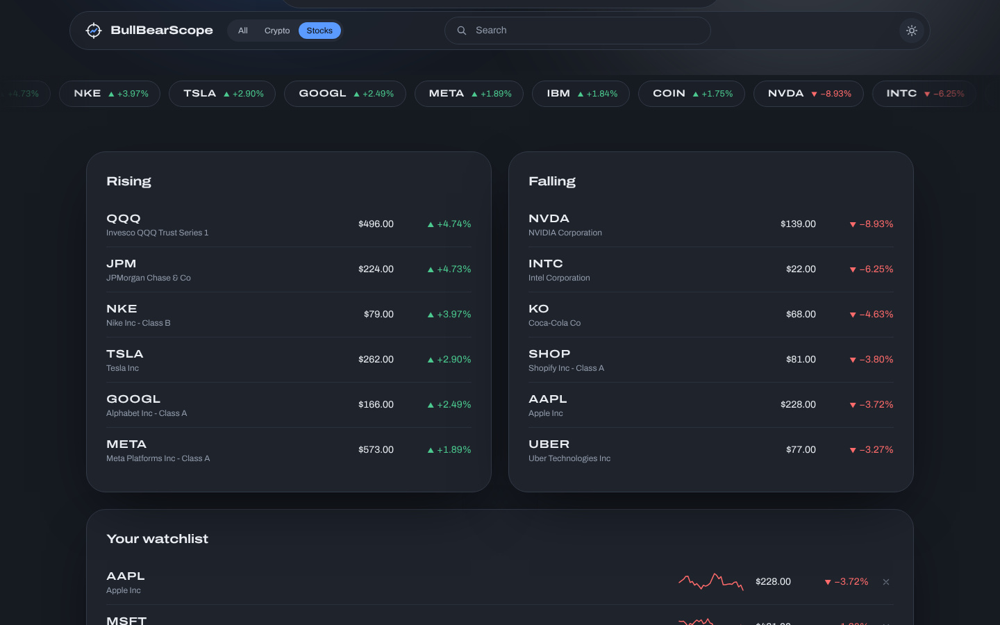
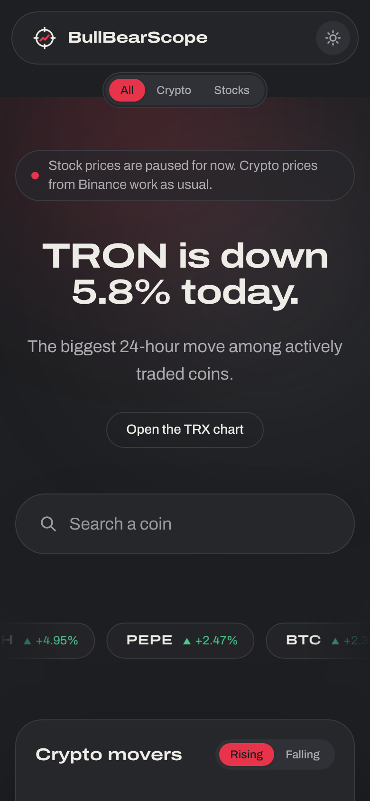
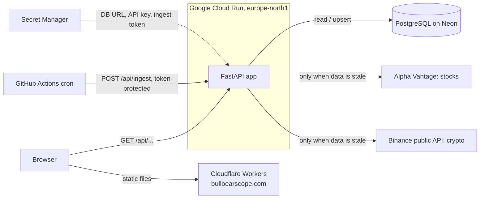

<div align="center">


# BullBearScope

**Watch the bulls and the bears.** A full-stack market tracker for US stocks and crypto.

[**bullbearscope.com**](https://bullbearscope.com) ·
[API docs](https://market-backend-u7emkto2ja-lz.a.run.app/docs) ·
[How it's built](#architecture)

[](https://github.com/EliasNiskanen/BullBearScope/actions/workflows/ci.yml)


</div>



BullBearScope shows the day's biggest gainers and losers in US stocks and
crypto, lets you search any listed company or coin, and opens a chart for it in
a popup above the page, with five time ranges and side-by-side comparison of
two assets. A **FastAPI** backend collects prices from public APIs into
**PostgreSQL**; a **React + TypeScript** frontend presents them. Everything
deploys automatically when a pull request is merged.

## Features

- **Three markets, three looks.** *All* (the front page) mixes stocks and
  crypto in graphite and red. *Crypto* switches to gold and blue, *Stocks* to
  blue and light grey. Each has a light and a dark theme, and every colour pair
  was checked for WCAG contrast.
- **A front page that tells the day's story.** The headline is written from
  live data ("NVIDIA Corporation is down 8.9% today."), a ticker ribbon drifts
  past, and the market lists fade in as you scroll.
- **Charts in a floating popup.** Click any row, ribbon chip or search result
  and a candlestick chart opens on top of the page. The URL updates
  (`?a=crypto:BTC-USDT`), so a chart can be bookmarked or shared, and the back
  button closes it.
- **Time ranges: 15 min, 1 day, 1 month, 1 year, all time.** Each range picks
  the right candle size per market (1-minute candles for 15 minutes, monthly
  candles for all time).
- **Compare two assets.** Pick a second stock or coin and both are drawn as
  percent change from the start of the range on one axis, so a $0.20 coin and a
  $500 stock are directly comparable.
- **Search** across 10,000+ US stocks and ETFs and every coin on Binance, with
  keyboard navigation (`/` focuses it).
- **Watchlist** with sparklines, saved in the browser.
- **Accessible and responsive.** Native `<dialog>` with focus handling,
  ▲/▼ next to every gain/loss colour, keyboard-operable controls, motion turned
  off for `prefers-reduced-motion`, and no sideways scrolling on phones.

<table>
  <tr>
    <td width="50%"></td>
    <td width="50%"></td>
  </tr>
  <tr>
    <td><sub>Chart popup in Crypto mode (dark)</sub></td>
    <td><sub>Comparing two stocks over a year (light)</sub></td>
  </tr>
  <tr>
    <td></td>
    <td></td>
  </tr>
  <tr>
    <td><sub>Crypto mode (light)</sub></td>
    <td><sub>Stocks mode (dark)</sub></td>
  </tr>
</table>

<p align="center"></p>

<sub>Screenshots use the local demo data server (`dev/fake_market_api.py`).</sub>

## The problem

Free market data APIs are heavily rate limited. Alpha Vantage's free key, for
example, allows only a small number of requests per day. A chart that calls the
API directly on every page load would hit that limit almost immediately.

This backend solves that by being **database-first**: every response comes from
my own PostgreSQL database, and the external API is called only when the
stored data is older than a configurable time-to-live (TTL). A scheduled job
also pulls new data every day, so price history keeps growing even when nobody
has the app open.

## Architecture



Request flow for `GET /api/crypto/BTC?quote=EUR`:

1. The router validates the input (symbol format, interval, limit) with FastAPI and Pydantic.
2. The service layer checks the `fetch_log` table: when was `BTCEUR / 5min` last fetched?
3. If the data is fresh, it is read straight from PostgreSQL.
4. If it is stale, the Binance client downloads the latest candles, the service
   upserts them, and the read happens after that.
5. The response is serialized with all timestamps in UTC, oldest first, ready for a chart library.

## Tech stack and how it is used

| Technology | How it is used in this project |
|---|---|
| **Python 3.13** | Language for the backend. Type hints throughout. |
| **FastAPI** | REST API, request validation (path/query constraints such as symbol regex and limit ranges), dependency injection for DB sessions, settings and API clients, and auto-generated OpenAPI docs at `/docs`. |
| **Pydantic / pydantic-settings** | Response schemas (`app/schemas.py`) and typed configuration from environment variables (`app/config.py`), so the same image runs locally and in the cloud. |
| **SQLAlchemy 2.x (ORM)** | Database models (`price_bars`, `fetch_log`, `api_cache`) and queries. Writes use dialect-specific `INSERT ... ON CONFLICT DO UPDATE`, so concurrent requests can't collide. Connection pool with `pool_pre_ping` to survive serverless databases closing idle connections. |
| **PostgreSQL** | Persistent storage of OHLCV candles. A unique constraint on `(asset_class, symbol, interval, ts)` prevents duplicates. Hosted on **Neon** (serverless Postgres) in production and run in Docker locally. |
| **Alembic** | Versioned schema migrations, including a data-preserving migration that added crypto support (new column, primary key change, integer to decimal volume). Runs automatically on container start. |
| **psycopg 3** | PostgreSQL driver. |
| **httpx** | HTTP client for the external APIs, with timeouts. Its `MockTransport` lets tests simulate the APIs without network access. |
| **Alpha Vantage API** | Source for stock prices, daily top gainers and losers, and the list of all listed US symbols (a weekly-cached CSV that powers stock search). Its errors arrive as HTTP 200 with special JSON keys, which the client translates into proper exceptions. |
| **Binance public market data API** | Source for crypto candles (`/api/v3/klines`) and 24-hour statistics for every pair (`/api/v3/ticker/24hr`), free and keyless. One cached 24h response feeds the movers, the market table and crypto search. |
| **pytest** | Unit and API tests with in-memory SQLite and fake data sources, plus a concurrency regression test that runs against real PostgreSQL in CI. |
| **Ruff** | Linting and formatting, enforced in CI. |
| **Poetry** | Dependency management with a lock file for reproducible builds. |
| **Docker** | Multi-stage image: dependencies are resolved with Poetry in a build stage, and the runtime stage contains only the virtualenv and code, running as a non-root user. **Docker Compose** runs the API with PostgreSQL locally. |
| **GitHub Actions** | CI on every push and pull request: backend lint, tests and migrations against a real PostgreSQL service container (`alembic check` catches model/migration drift); frontend lint, type check, unit tests and Playwright tests; both Docker images built, and the frontend image started and smoke-tested. A second workflow runs the scheduled data ingest. |
| **React 19 + TypeScript** | The frontend (`frontend/`). Strict TypeScript. UI state that should survive a reload or be shareable (market mode, open chart) lives in the URL; the theme and watchlist live in `localStorage`, read through `useSyncExternalStore`. |
| **Vite** | Dev server and build. In development it proxies `/api` to the backend, so no CORS setup is needed locally. |
| **TanStack Query** | All data fetching: caching, request de-duplication (several panels showing the same asset share one request), keeping the previous chart visible while a new interval loads, and no retries on 404/503 so the provider quota isn't wasted. |
| **openapi-typescript** | Generates TypeScript types from the backend's OpenAPI schema, so a change in the API's response shape becomes a compile error in the frontend. |
| **TradingView Lightweight Charts** | Candlestick and volume chart with crosshair readout. |
| **Custom SVG charts** | The comparison chart (both assets rebased to percent change on one axis, with a legend, labelled line ends and a hover tooltip) and the sparklines. |
| **Tailwind CSS 4** | Styling from design tokens. Each market mode and theme is one block of CSS variables on `<html data-mode data-theme>`, so switching recolours the whole page, the canvas chart included, without re-rendering components. |
| **Modern CSS** | Native `<dialog>` with `@starting-style` enter/exit transitions and a blurred backdrop, drifting gradient orbs, a CSS marquee and scroll reveals with `IntersectionObserver`. All motion stops under `prefers-reduced-motion`. |
| **Vitest + Testing Library** | Unit tests for formatting, asset keys, series maths, time ranges, mode handling, chart axis helpers, the watchlist hook, the API client and the search combobox. |
| **Playwright** | End-to-end tests on desktop and mobile viewports against a mocked API: mode switching, theme persistence, opening and closing the chart popup, every time range, search, comparison, watchlist persistence, error states and no horizontal scrolling. |
| **Oxlint + Prettier** | Linting and formatting for the frontend, enforced in CI. |
| **Cloudflare Workers (static assets)** | Hosts the frontend at bullbearscope.com on Cloudflare's edge network. Cloudflare builds and deploys `frontend/` on every push to `main` (`wrangler.jsonc`, SPA routing, security headers in `public/_headers`). |
| **Google Cloud Run** | Hosts the backend. A serverless container that scales to zero, so it costs nothing while idle. Built with **Cloud Build** and stored in **Artifact Registry**. |
| **Continuous deployment** | After CI passes on `main`, a GitHub Actions workflow deploys the backend to Cloud Run. It signs in with **Workload Identity Federation** (OIDC), so no long-lived Google Cloud key is stored in GitHub. |
| **nginx** | Alternative frontend container (also Cloud Run). The backend address is written into `config.js` at container start, so one image works in every environment. |
| **Google Secret Manager** | Holds the database URL, API key and ingest token. The app runs as a dedicated service account that may only read those secrets (least privilege). |
| **AWS (ECS Express Mode, ECR, RDS, SSM)** | An alternative deployment path, documented in [docs/DEPLOY.md](docs/DEPLOY.md), with GitHub OIDC so no long-lived cloud keys are stored in GitHub. Prepared but not in use. |

## Engineering decisions

**Database-first caching instead of an in-memory cache.** Price history is the
product, not just a performance optimization. Storing it in PostgreSQL means
the data survives restarts and scale-to-zero, keeps growing over time, and can
later be analyzed with SQL.

**Upsert instead of insert-only.** A candle that is still open when first
fetched (today's daily bar, for example) would otherwise be stored with
unfinished values forever. Ingest updates existing rows, so the next fetch
corrects them.

**One table for stocks and crypto.** An `asset_class` column keeps both in the
same schema, so the frontend receives one consistent JSON shape. Volume is
stored as `NUMERIC` because crypto volumes are fractional (0.53 BTC).

**Provider-independent core.** Each API client converts its own format into a
shared `Bar` type and shared error types (`app/services/market.py`). The
caching layer and routers never see provider details, so adding a new data
source does not touch them.

**Stale data beats an error page.** If a provider is rate limited or down
when stored data needs a refresh, the backend serves what it has with
`stale: true`, and the frontend says so. Only data that was never fetched
produces an error.

**Atomic upserts, found by testing in the browser.** The dashboard's panels
load in parallel, so the first visit to a new asset sent several requests that
all tried to insert the same candles; all but one failed on the unique
constraint. Ingest now uses a single `INSERT ... ON CONFLICT DO UPDATE`
statement, and `tests/test_concurrency.py` reproduces the race with eight
threads against real PostgreSQL.

**One request, many panels.** Market-wide data (Binance 24h tickers, stock
movers, the symbol list) lives in an `api_cache` table with its own TTL. One
Binance response feeds the movers, the market table and crypto search, and
stock movers refresh every six hours to respect the free Alpha Vantage quota.

**Charts on demand, not on arrival.** The front page answers "what moved
today?" with lists, and a chart opens only for the asset you pick. That keeps
the first load to a handful of cached, market-wide requests, which matters with
a rate-limited stock API, and puts the chart where your attention already is.

**The URL is the state.** The market mode (`?m=crypto`) and the open chart
(`?a=stock:AAPL`) are query parameters. Opening a chart pushes a history entry,
so the back button closes it on phones, and any view can be shared as a link.

**Comparison by percent, on one axis.** Two prices on two y-axes invite false
conclusions about which moved more. Rebasing both to 0% at the start of the
range answers the actual question. The two series colours were picked and
validated for colour-vision deficiencies, and every value is also labelled.

**Clear error mapping.** Unknown symbol gives 404, provider rate limit gives
503 with `Retry-After`, provider unreachable gives 502, and database
unavailable gives 503. Clients can tell "you asked for something wrong" apart
from "try again later".

**Twelve-factor configuration.** All configuration comes from environment
variables. Secrets never live in the code or the image.

**Security details.** The ingest endpoints require an `X-Ingest-Token` header.
Path and query parameters are validated with regular expressions before they
reach any query or outgoing request. The HTTP client's request logging is
turned down so the API key, which Alpha Vantage requires in the URL, never ends
up in logs.

## API

| Method | Endpoint | Description |
|---|---|---|
| GET | `/api/stocks/{symbol}?interval=5min&limit=500` | Stock candles, e.g. `IBM` |
| GET | `/api/crypto/{base}?quote=USDT&interval=5min&limit=500` | Crypto candles, e.g. `BTC` with `quote=EUR` |
| GET | `/api/market/movers?asset_class=crypto&limit=8` | Biggest daily gainers and losers (`stock` or `crypto`) |
| GET | `/api/market/crypto?symbols=BTC,ETH` | 24h price, change and volume for coins (default: major coins) |
| GET | `/api/search?q=apple` | Stocks, ETFs and coins by ticker or name |
| POST | `/api/ingest/{symbol}` | Force a stock fetch (requires `X-Ingest-Token`) |
| POST | `/api/ingest/crypto/{base}?quote=EUR` | Force a crypto fetch (requires `X-Ingest-Token`) |
| GET | `/health` | Liveness check |
| GET | `/health/ready` | Readiness check (database reachable) |

Intervals: `1min`, `5min`, `15min`, `30min`, `60min`, `daily`, `weekly`, `monthly`.

Example response (values shortened for illustration):

```json
{
  "asset_class": "crypto",
  "symbol": "BTCEUR",
  "interval": "daily",
  "bars": [
    {"ts": "2026-10-26T00:00:00Z", "open": 71000.1, "high": 72100.0, "low": 70500.5, "close": 71348.5, "volume": 312.4}
  ]
}
```

## Testing and quality

- **Backend (pytest):** both API clients' parsing, timezone conversion and
  error paths against simulated HTTP; caching (a second request doesn't call
  the provider), stale fallbacks, upserting an open candle, movers filtering,
  search ranking, validation, status codes, token protection, and a
  concurrency test on real PostgreSQL.
- **Frontend (Vitest):** formatting, asset keys, series maths, time ranges,
  market modes, chart axis helpers, the watchlist hook, the API client and the
  search combobox.
- **End to end (Playwright):** the real app in Chromium at desktop and mobile
  sizes, with the API mocked by fixtures.
- **CI** also applies all migrations to PostgreSQL 16, builds both Docker
  images and smoke-tests the frontend image.

```bash
poetry run pytest                     # backend
cd frontend && npm test && npm run e2e  # frontend
```

## Run locally

Backend with Docker (API + PostgreSQL):

```bash
cp .env.example .env        # add your Alpha Vantage key
docker compose up --build
```

Frontend (in another terminal):

```bash
cd frontend
npm install
npm run dev                 # http://localhost:5173, proxies /api to localhost:8000
```

No API key? `dev/fake_market_api.py` imitates Alpha Vantage and Binance with
realistic random data:

```bash
python dev/fake_market_api.py --port 9100 &
ALPHAVANTAGE_API_KEY=dev ALPHAVANTAGE_BASE_URL=http://127.0.0.1:9100/query \
BINANCE_BASE_URL=http://127.0.0.1:9100 poetry run uvicorn app.main:app --reload
```

The frontend can also run against the deployed backend:
`API_PROXY_TARGET=https://market-backend-u7emkto2ja-lz.a.run.app npm run dev`.

## Deployment

Merging a pull request into `main` ships it:

| Part | Where | How it deploys |
|---|---|---|
| Frontend | Cloudflare Workers, [bullbearscope.com](https://bullbearscope.com) | Cloudflare's GitHub integration builds `frontend/` and publishes `dist/` |
| Backend | Google Cloud Run, `europe-north1` | [`deploy-backend.yml`](.github/workflows/deploy-backend.yml) runs after CI succeeds, signing in with Workload Identity Federation |
| Database | Neon PostgreSQL | Alembic migrations run on container start |

The one-time Google Cloud setup is scripted and safe to re-run:
[`deploy/gcp/setup.sh`](deploy/gcp/setup.sh) (APIs, secrets, a least-privilege
service account, first deploy and a health check) and
[`deploy/gcp/github-deploy-setup.sh`](deploy/gcp/github-deploy-setup.sh)
(the keyless GitHub to Google Cloud trust). [docs/DEPLOY.md](docs/DEPLOY.md)
covers these, Cloud SQL, the Cloudflare setup and an AWS alternative.

## Project layout

```
app/                   FastAPI backend
  main.py              app, error handlers, health checks
  config.py            settings from environment variables
  db.py, models.py     SQLAlchemy engine and tables
  schemas.py           response models
  routers/             HTTP endpoints (stocks, crypto, market, shared deps)
  services/
    market.py          shared types (Bar, intervals, errors)
    alphavantage.py    stock data client
    binance.py         crypto data client
    prices.py          database-first candle caching and ingest
    cache.py           database-backed cache for market-wide JSON
    markets.py         movers, crypto overview, search
    upsert.py          INSERT ... ON CONFLICT for PostgreSQL and SQLite
alembic/               database migrations
tests/                 pytest suite
frontend/              React + TypeScript app
  src/api/             typed API client, generated schema, query hooks
  src/components/      header, hero, ribbon, market lists, chart popup, charts
  src/lib/             modes and themes, time ranges, URL state, formatting, series maths
  wrangler.jsonc       Cloudflare Workers config
  e2e/                 Playwright tests and API fixtures
  deploy/              nginx config and runtime config script
dev/                   offline fake market data server
deploy/                GCP scripts, AWS container definition
.github/workflows/     CI, scheduled ingest, deploy workflows
docs/                  deployment guide, screenshots
```

## Roadmap

- Derived indicators computed from stored history, such as moving averages and volatility
- Comparing more than two assets at once
- More data sources behind the same provider interface
