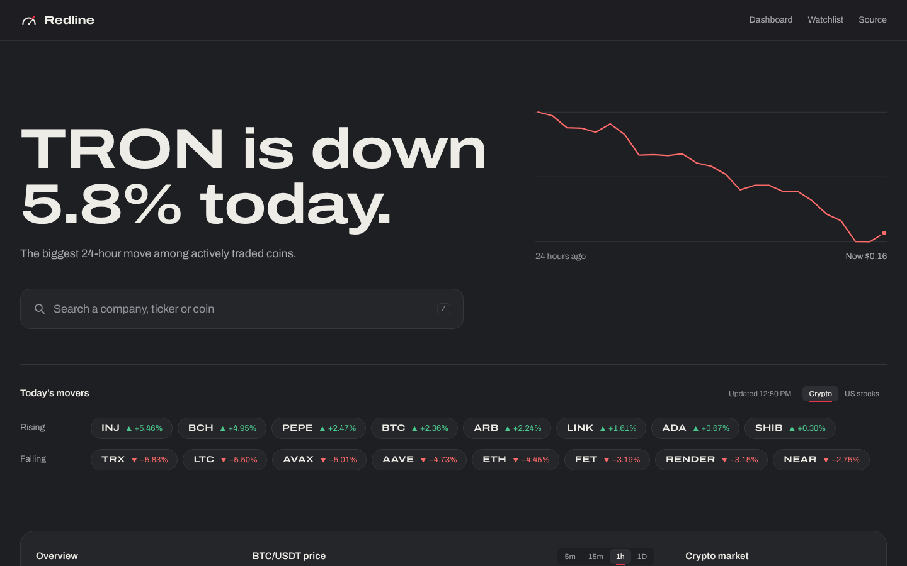
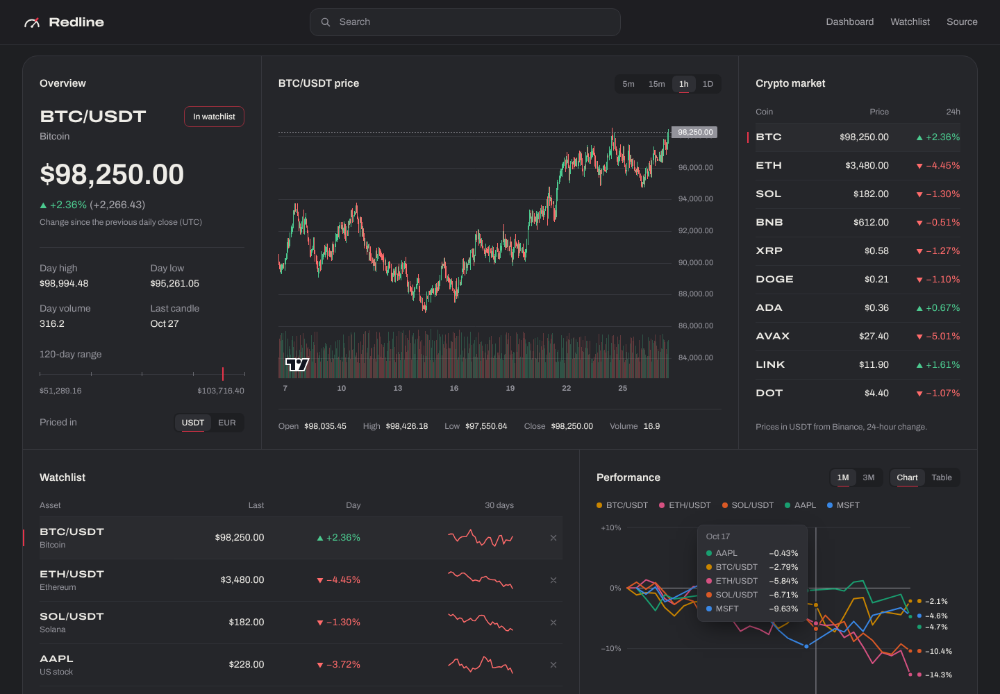
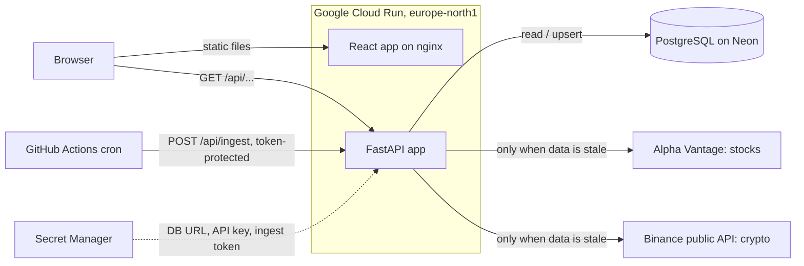

# Redline: a full-stack stock and crypto dashboard

[](https://github.com/EliasNiskanen/FastAPI-backend/actions/workflows/ci.yml)

Redline lets you search US stocks and crypto, see the day's biggest gainers and
losers, and study prices on interactive candlestick and comparison charts. A
**FastAPI** backend collects price data from public APIs into **PostgreSQL**;
a **React + TypeScript** frontend visualizes it. Both run on **Google Cloud Run**.

**Live API docs:** https://market-backend-u7emkto2ja-lz.a.run.app/docs





<sub>Screenshots use the local demo data server (`dev/fake_market_api.py`).</sub>

## The problem

Free market data APIs are heavily rate limited. Alpha Vantage's free key, for
example, allows only a small number of requests per day. A chart that calls the
API directly on every page load would hit that limit almost immediately.

This backend solves that by being **database-first**: every response comes from
my own PostgreSQL database, and the external API is called only when the
stored data is older than a configurable time-to-live (TTL). A scheduled job
also pulls new data every day, so price history keeps growing even when nobody
has the app open.

## Architecture



Request flow for `GET /api/crypto/BTC?quote=EUR`:

1. The router validates the input (symbol format, interval, limit) with FastAPI and Pydantic.
2. The service layer checks the `fetch_log` table: when was `BTCEUR / 5min` last fetched?
3. If the data is fresh, it is read straight from PostgreSQL.
4. If it is stale, the Binance client downloads the latest candles, the service
   upserts them, and the read happens after that.
5. The response is serialized with all timestamps in UTC, oldest first, ready for a chart library.

## Tech stack and how it is used

| Technology | How it is used in this project |
|---|---|
| **Python 3.13** | Language for the backend. Type hints throughout. |
| **FastAPI** | REST API, request validation (path/query constraints such as symbol regex and limit ranges), dependency injection for DB sessions, settings and API clients, and auto-generated OpenAPI docs at `/docs`. |
| **Pydantic / pydantic-settings** | Response schemas (`app/schemas.py`) and typed configuration from environment variables (`app/config.py`), so the same image runs locally and in the cloud. |
| **SQLAlchemy 2.x (ORM)** | Database models (`price_bars`, `fetch_log`, `api_cache`) and queries. Writes use dialect-specific `INSERT ... ON CONFLICT DO UPDATE`, so concurrent requests can't collide. Connection pool with `pool_pre_ping` to survive serverless databases closing idle connections. |
| **PostgreSQL** | Persistent storage of OHLCV candles. A unique constraint on `(asset_class, symbol, interval, ts)` prevents duplicates. Hosted on **Neon** (serverless Postgres) in production and run in Docker locally. |
| **Alembic** | Versioned schema migrations, including a data-preserving migration that added crypto support (new column, primary key change, integer to decimal volume). Runs automatically on container start. |
| **psycopg 3** | PostgreSQL driver. |
| **httpx** | HTTP client for the external APIs, with timeouts. Its `MockTransport` lets tests simulate the APIs without network access. |
| **Alpha Vantage API** | Source for stock prices, daily top gainers and losers, and the list of all listed US symbols (a weekly-cached CSV that powers stock search). Its errors arrive as HTTP 200 with special JSON keys, which the client translates into proper exceptions. |
| **Binance public market data API** | Source for crypto candles (`/api/v3/klines`) and 24-hour statistics for every pair (`/api/v3/ticker/24hr`), free and keyless. One cached 24h response feeds the movers, the market table and crypto search. |
| **pytest** | Unit and API tests with in-memory SQLite and fake data sources, plus a concurrency regression test that runs against real PostgreSQL in CI. |
| **Ruff** | Linting and formatting, enforced in CI. |
| **Poetry** | Dependency management with a lock file for reproducible builds. |
| **Docker** | Multi-stage image: dependencies are resolved with Poetry in a build stage, and the runtime stage contains only the virtualenv and code, running as a non-root user. **Docker Compose** runs the API with PostgreSQL locally. |
| **GitHub Actions** | CI on every push and pull request: backend lint, tests and migrations against a real PostgreSQL service container (`alembic check` catches model/migration drift); frontend lint, type check, unit tests and Playwright tests; both Docker images built, and the frontend image started and smoke-tested. A second workflow runs the scheduled data ingest. |
| **React 19 + TypeScript** | The frontend (`frontend/`). Strict TypeScript; components for search, movers, the candlestick chart, watchlist and comparison chart. |
| **Vite** | Dev server and build. In development it proxies `/api` to the backend, so no CORS setup is needed locally. |
| **TanStack Query** | All data fetching: caching, request de-duplication (several panels showing the same asset share one request), keeping the previous chart visible while a new interval loads, and no retries on 404/503 so the provider quota isn't wasted. |
| **openapi-typescript** | Generates TypeScript types from the backend's OpenAPI schema, so a change in the API's response shape becomes a compile error in the frontend. |
| **TradingView Lightweight Charts** | Candlestick and volume chart with crosshair readout. |
| **Custom SVG charts** | The performance comparison (every asset rebased to percent change on one axis, with direct labels, a hover tooltip and a table view), sparklines and the hero chart. |
| **Tailwind CSS 4** | Styling from a small set of design tokens (graphite surfaces, one signal red, separate gain/loss colours that always come with ▲/▼). |
| **Vitest + Testing Library** | Unit tests for formatting, asset keys, series maths, colour assignment, the watchlist hook, the API client and the search combobox. |
| **Playwright** | End-to-end tests on desktop and mobile viewports against a mocked API: headline, movers, search, watchlist persistence, error states and no horizontal scrolling. |
| **Oxlint + Prettier** | Linting and formatting for the frontend, enforced in CI. |
| **nginx** | Serves the built frontend in its container. The backend address is written into `config.js` at container start, so one image works in every environment. |
| **Google Cloud Run** | Production hosting for both services. Serverless containers that scale to zero, so the app costs nothing while idle. Deployed from source with **Cloud Build** and **Artifact Registry** by two re-runnable scripts. |
| **Google Secret Manager** | Holds the database URL, API key and ingest token. The app runs as a dedicated service account that may only read those secrets (least privilege). |
| **AWS (ECS Express Mode, ECR, RDS, SSM)** | An alternative deployment path, documented in [docs/DEPLOY.md](docs/DEPLOY.md), with GitHub OIDC so no long-lived cloud keys are stored in GitHub. Prepared but not in use. |

## Engineering decisions

**Database-first caching instead of an in-memory cache.** Price history is the
product, not just a performance optimization. Storing it in PostgreSQL means
the data survives restarts and scale-to-zero, keeps growing over time, and can
later be analyzed with SQL.

**Upsert instead of insert-only.** A candle that is still open when first
fetched (today's daily bar, for example) would otherwise be stored with
unfinished values forever. Ingest updates existing rows, so the next fetch
corrects them.

**One table for stocks and crypto.** An `asset_class` column keeps both in the
same schema, so the frontend receives one consistent JSON shape. Volume is
stored as `NUMERIC` because crypto volumes are fractional (0.53 BTC).

**Provider-independent core.** Each API client converts its own format into a
shared `Bar` type and shared error types (`app/services/market.py`). The
caching layer and routers never see provider details, so adding a new data
source does not touch them.

**Stale data beats an error page.** If a provider is rate limited or down
when stored data needs a refresh, the backend serves what it has with
`stale: true`, and the frontend says so. Only data that was never fetched
produces an error.

**Atomic upserts, found by testing in the browser.** The dashboard's panels
load in parallel, so the first visit to a new asset sent several requests that
all tried to insert the same candles; all but one failed on the unique
constraint. Ingest now uses a single `INSERT ... ON CONFLICT DO UPDATE`
statement, and `tests/test_concurrency.py` reproduces the race with eight
threads against real PostgreSQL.

**One request, many panels.** Market-wide data (Binance 24h tickers, stock
movers, the symbol list) lives in an `api_cache` table with its own TTL. One
Binance response feeds the movers, the market table and crypto search, and
stock movers refresh every six hours to respect the free Alpha Vantage quota.

**Clear error mapping.** Unknown symbol gives 404, provider rate limit gives
503 with `Retry-After`, provider unreachable gives 502, and database
unavailable gives 503. Clients can tell "you asked for something wrong" apart
from "try again later".

**Twelve-factor configuration.** All configuration comes from environment
variables. Secrets never live in the code or the image.

**Security details.** The ingest endpoints require an `X-Ingest-Token` header.
Path and query parameters are validated with regular expressions before they
reach any query or outgoing request. The HTTP client's request logging is
turned down so the API key, which Alpha Vantage requires in the URL, never ends
up in logs.

## API

| Method | Endpoint | Description |
|---|---|---|
| GET | `/api/stocks/{symbol}?interval=5min&limit=500` | Stock candles, e.g. `IBM` |
| GET | `/api/crypto/{base}?quote=USDT&interval=5min&limit=500` | Crypto candles, e.g. `BTC` with `quote=EUR` |
| GET | `/api/market/movers?asset_class=crypto&limit=8` | Biggest daily gainers and losers (`stock` or `crypto`) |
| GET | `/api/market/crypto?symbols=BTC,ETH` | 24h price, change and volume for coins (default: major coins) |
| GET | `/api/search?q=apple` | Stocks, ETFs and coins by ticker or name |
| POST | `/api/ingest/{symbol}` | Force a stock fetch (requires `X-Ingest-Token`) |
| POST | `/api/ingest/crypto/{base}?quote=EUR` | Force a crypto fetch (requires `X-Ingest-Token`) |
| GET | `/health` | Liveness check |
| GET | `/health/ready` | Readiness check (database reachable) |

Intervals: `1min`, `5min`, `15min`, `30min`, `60min`, `daily`.

Example response (values shortened for illustration):

```json
{
  "asset_class": "crypto",
  "symbol": "BTCEUR",
  "interval": "daily",
  "bars": [
    {"ts": "2026-10-26T00:00:00Z", "open": 71000.1, "high": 72100.0, "low": 70500.5, "close": 71348.5, "volume": 312.4}
  ]
}
```

## Testing and quality

- **Backend (pytest):** both API clients' parsing, timezone conversion and
  error paths against simulated HTTP; caching (a second request doesn't call
  the provider), stale fallbacks, upserting an open candle, movers filtering,
  search ranking, validation, status codes, token protection, and a
  concurrency test on real PostgreSQL.
- **Frontend (Vitest):** formatting, asset keys, series maths, stable colour
  assignment, the watchlist hook, the API client and the search combobox.
- **End to end (Playwright):** the real app in Chromium at desktop and mobile
  sizes, with the API mocked by fixtures.
- **CI** also applies all migrations to PostgreSQL 16, builds both Docker
  images and smoke-tests the frontend image.

```bash
poetry run pytest                     # backend
cd frontend && npm test && npm run e2e  # frontend
```

## Run locally

Backend with Docker (API + PostgreSQL):

```bash
cp .env.example .env        # add your Alpha Vantage key
docker compose up --build
```

Frontend (in another terminal):

```bash
cd frontend
npm install
npm run dev                 # http://localhost:5173, proxies /api to localhost:8000
```

No API key? `dev/fake_market_api.py` imitates Alpha Vantage and Binance with
realistic random data:

```bash
python dev/fake_market_api.py --port 9100 &
ALPHAVANTAGE_API_KEY=dev ALPHAVANTAGE_BASE_URL=http://127.0.0.1:9100/query \
BINANCE_BASE_URL=http://127.0.0.1:9100 poetry run uvicorn app.main:app --reload
```

The frontend can also run against the deployed backend:
`API_PROXY_TARGET=https://market-backend-u7emkto2ja-lz.a.run.app npm run dev`.

## Deployment

Production runs on Google Cloud Run (`europe-north1`) with a Neon PostgreSQL
database. [`deploy/gcp/setup.sh`](deploy/gcp/setup.sh) is a re-runnable script
that enables the needed APIs, stores secrets, creates a least-privilege service
account, builds and deploys the container, and checks `/health/ready`.

[`deploy/gcp/frontend.sh`](deploy/gcp/frontend.sh) then deploys the frontend
as a second Cloud Run service and allows its address in the backend's CORS
settings.

[docs/DEPLOY.md](docs/DEPLOY.md) also covers Cloud SQL, deploys from GitHub
Actions with keyless Workload Identity Federation, and AWS.

## Project layout

```
app/                   FastAPI backend
  main.py              app, error handlers, health checks
  config.py            settings from environment variables
  db.py, models.py     SQLAlchemy engine and tables
  schemas.py           response models
  routers/             HTTP endpoints (stocks, crypto, market, shared deps)
  services/
    market.py          shared types (Bar, intervals, errors)
    alphavantage.py    stock data client
    binance.py         crypto data client
    prices.py          database-first candle caching and ingest
    cache.py           database-backed cache for market-wide JSON
    markets.py         movers, crypto overview, search
    upsert.py          INSERT ... ON CONFLICT for PostgreSQL and SQLite
alembic/               database migrations
tests/                 pytest suite
frontend/              React + TypeScript app
  src/api/             typed API client, generated schema, query hooks
  src/components/      hero, search, panels and charts
  src/lib/             formatting, state, series maths
  e2e/                 Playwright tests and API fixtures
  deploy/              nginx config and runtime config script
dev/                   offline fake market data server
deploy/                GCP scripts, AWS container definition
.github/workflows/     CI, scheduled ingest, deploy workflows
docs/                  deployment guide, screenshots
```

## Roadmap

- Derived indicators computed from stored history, such as moving averages and volatility
- More data sources behind the same provider interface
