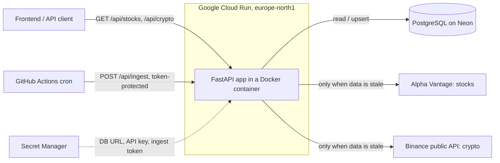

# Market Data Backend: stocks and crypto

[](https://github.com/EliasNiskanen/FastAPI-backend/actions/workflows/ci.yml)

A Python/FastAPI backend that collects stock and cryptocurrency price data from
public APIs, stores it in PostgreSQL, and serves it to a visualization
frontend through a REST API. It runs in production on Google Cloud Run.

**Live API docs:** https://market-backend-u7emkto2ja-lz.a.run.app/docs

```bash
curl "https://market-backend-u7emkto2ja-lz.a.run.app/api/crypto/BTC?quote=EUR&interval=daily&limit=30"
curl "https://market-backend-u7emkto2ja-lz.a.run.app/api/stocks/IBM?interval=daily&limit=30"
```

## The problem

Free market data APIs are heavily rate limited. Alpha Vantage's free key, for
example, allows only a small number of requests per day. A chart that calls the
API directly on every page load would hit that limit almost immediately.

This backend solves that by being **database-first**: every response comes from
my own PostgreSQL database, and the external API is called only when the
stored data is older than a configurable time-to-live (TTL). A scheduled job
also pulls new data every day, so price history keeps growing even when nobody
has the app open.

## Architecture



Request flow for `GET /api/crypto/BTC?quote=EUR`:

1. The router validates the input (symbol format, interval, limit) with FastAPI and Pydantic.
2. The service layer checks the `fetch_log` table: when was `BTCEUR / 5min` last fetched?
3. If the data is fresh, it is read straight from PostgreSQL.
4. If it is stale, the Binance client downloads the latest candles, the service
   upserts them, and the read happens after that.
5. The response is serialized with all timestamps in UTC, oldest first, ready for a chart library.

## Tech stack and how it is used

| Technology | How it is used in this project |
|---|---|
| **Python 3.13** | Language for the whole backend. Type hints throughout. |
| **FastAPI** | REST API, request validation (path/query constraints such as symbol regex and limit ranges), dependency injection for DB sessions, settings and API clients, and auto-generated OpenAPI docs at `/docs`. |
| **Pydantic / pydantic-settings** | Response schemas (`app/schemas.py`) and typed configuration from environment variables (`app/config.py`), so the same image runs locally and in the cloud. |
| **SQLAlchemy 2.x (ORM)** | Database models (`price_bars`, `fetch_log`) and queries. Connection pool with `pool_pre_ping` to survive serverless databases closing idle connections. |
| **PostgreSQL** | Persistent storage of OHLCV candles. A unique constraint on `(asset_class, symbol, interval, ts)` prevents duplicates. Hosted on **Neon** (serverless Postgres) in production and run in Docker locally. |
| **Alembic** | Versioned schema migrations, including a data-preserving migration that added crypto support (new column, primary key change, integer to decimal volume). Runs automatically on container start. |
| **psycopg 3** | PostgreSQL driver. |
| **httpx** | HTTP client for the external APIs, with timeouts. Its `MockTransport` lets tests simulate the APIs without network access. |
| **Alpha Vantage API** | Source for stock prices (intraday and daily). Its errors arrive as HTTP 200 with special JSON keys, which the client translates into proper exceptions. |
| **Binance public market data API** | Source for crypto prices (`/api/v3/klines`), free and keyless. Unfinished candles are skipped, and interval names are mapped between the two providers. |
| **pytest** | Unit and API tests. Tests use in-memory SQLite and fake data fetchers, so they never touch the network or a real database. |
| **Ruff** | Linting and formatting, enforced in CI. |
| **Poetry** | Dependency management with a lock file for reproducible builds. |
| **Docker** | Multi-stage image: dependencies are resolved with Poetry in a build stage, and the runtime stage contains only the virtualenv and code, running as a non-root user. **Docker Compose** runs the API with PostgreSQL locally. |
| **GitHub Actions** | CI on every push and pull request: lint, format check, tests, migrations applied to a real PostgreSQL service container with `alembic check` to catch model/migration drift, and a Docker build. A second workflow runs the scheduled data ingest. Manual deploy workflows exist for GCP and AWS. |
| **Google Cloud Run** | Production hosting. Serverless containers that scale to zero, so the app costs nothing while idle. Deployed from source with **Cloud Build** and **Artifact Registry**. |
| **Google Secret Manager** | Holds the database URL, API key and ingest token. The app runs as a dedicated service account that may only read those secrets (least privilege). |
| **AWS (ECS Express Mode, ECR, RDS, SSM)** | An alternative deployment path, documented in [docs/DEPLOY.md](docs/DEPLOY.md), with GitHub OIDC so no long-lived cloud keys are stored in GitHub. Prepared but not in use. |

## Engineering decisions

**Database-first caching instead of an in-memory cache.** Price history is the
product, not just a performance optimization. Storing it in PostgreSQL means
the data survives restarts and scale-to-zero, keeps growing over time, and can
later be analyzed with SQL.

**Upsert instead of insert-only.** A candle that is still open when first
fetched (today's daily bar, for example) would otherwise be stored with
unfinished values forever. Ingest updates existing rows, so the next fetch
corrects them.

**One table for stocks and crypto.** An `asset_class` column keeps both in the
same schema, so the frontend receives one consistent JSON shape. Volume is
stored as `NUMERIC` because crypto volumes are fractional (0.53 BTC).

**Provider-independent core.** Each API client converts its own format into a
shared `Bar` type and shared error types (`app/services/market.py`). The
caching layer and routers never see provider details, so adding a new data
source does not touch them.

**Clear error mapping.** Unknown symbol gives 404, provider rate limit gives
503 with `Retry-After`, provider unreachable gives 502, and database
unavailable gives 503. Clients can tell "you asked for something wrong" apart
from "try again later".

**Twelve-factor configuration.** All configuration comes from environment
variables. Secrets never live in the code or the image.

**Security details.** The ingest endpoints require an `X-Ingest-Token` header.
Path and query parameters are validated with regular expressions before they
reach any query or outgoing request. The HTTP client's request logging is
turned down so the API key, which Alpha Vantage requires in the URL, never ends
up in logs.

## API

| Method | Endpoint | Description |
|---|---|---|
| GET | `/api/stocks/{symbol}?interval=5min&limit=500` | Stock candles, e.g. `IBM` |
| GET | `/api/crypto/{base}?quote=USDT&interval=5min&limit=500` | Crypto candles, e.g. `BTC` with `quote=EUR` |
| POST | `/api/ingest/{symbol}` | Force a stock fetch (requires `X-Ingest-Token`) |
| POST | `/api/ingest/crypto/{base}?quote=EUR` | Force a crypto fetch (requires `X-Ingest-Token`) |
| GET | `/health` | Liveness check |
| GET | `/health/ready` | Readiness check (database reachable) |

Intervals: `1min`, `5min`, `15min`, `30min`, `60min`, `daily`.

Example response (values shortened for illustration):

```json
{
  "asset_class": "crypto",
  "symbol": "BTCEUR",
  "interval": "daily",
  "bars": [
    {"ts": "2026-10-26T00:00:00Z", "open": 71000.1, "high": 72100.0, "low": 70500.5, "close": 71348.5, "volume": 312.4}
  ]
}
```

## Testing and quality

- Unit tests for both API clients: response parsing, timezone conversion,
  interval mapping and every error path, all against simulated HTTP responses.
- API tests for caching (a second request does not call the external API),
  stale-data refresh without duplicates, upserting an open candle, stock/crypto
  separation, input validation, error status codes and token protection.
- CI also applies all migrations to a real PostgreSQL 16 instance and verifies
  that the models and migrations match.

```bash
poetry run pytest
poetry run ruff check .
```

## Run locally

With Docker (API + PostgreSQL):

```bash
cp .env.example .env        # add your Alpha Vantage key
docker compose up --build
```

Without Docker (needs a local PostgreSQL):

```bash
poetry install
cp .env.example .env
poetry run alembic upgrade head
poetry run uvicorn app.main:app --reload
```

Then open http://localhost:8000/docs.

## Deployment

Production runs on Google Cloud Run (`europe-north1`) with a Neon PostgreSQL
database. [`deploy/gcp/setup.sh`](deploy/gcp/setup.sh) is a re-runnable script
that enables the needed APIs, stores secrets, creates a least-privilege service
account, builds and deploys the container, and checks `/health/ready`.

[docs/DEPLOY.md](docs/DEPLOY.md) also covers Cloud SQL, deploys from GitHub
Actions with keyless Workload Identity Federation, and AWS.

## Project layout

```
app/
  main.py              FastAPI app, error handlers, health checks
  config.py            settings from environment variables
  db.py, models.py     SQLAlchemy engine and tables
  schemas.py           response models
  routers/             HTTP endpoints (stocks.py, crypto.py, shared deps.py)
  services/
    market.py          shared types (Bar, intervals, errors)
    alphavantage.py    stock data client
    binance.py         crypto data client
    prices.py          database-first caching and ingest logic
alembic/               database migrations
tests/                 pytest suite (no network, SQLite)
deploy/                GCP setup script, AWS container definition
.github/workflows/     CI, scheduled ingest, deploy workflows
docs/DEPLOY.md         deployment guide
```

## Roadmap

- Frontend that visualizes the data (charts, comparisons)
- Derived indicators computed from stored history, such as moving averages and volatility
- More data sources behind the same provider interface
